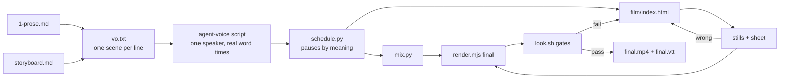

# Stage 4: the video

A 2 to 3 minute film of the lesson's story arc: the bug, the first worked example, the reveal, the fix. The derivation and the second example stay on the page. motionmaxxing supplies the runtime, the render and the gates. The lesson supplies the idea.



## 1. Storyboard

Write `4-video/storyboard.md` first: the PAGE header from motionmaxxing `references/director.md` section 0, the voice description, then one row per scene (8 to 12 scenes):

| # | Time | Purpose | Composition | Motion | Narration | On-screen text | Sound | Transition | Check |
|---|---|---|---|---|---|---|---|---|---|

Scene order follows the story: the bug, the familiar situation, worked example 1 on screen, the mechanism, the reveal (the hero frame at 60 to 75% of the film), the fix, the recap and the next bug.

- Diagram elements become scene objects with the same color and position.
- On-screen text labels values, names and units. It never repeats the narration.

## 2. Voice

Cut the narration from the prose. Do not write it fresh. Keep the teacher's voice, and shorten it for the ear: 300 to 400 words, one scene per line in `vo.txt`. A line may hold several sentences. Write numbers as words.

Choose the speaker and write it in the storyboard header:

- English or Chinese: design a voice that fits the lesson, for example `--voice "female, middle-aged, low pitch, american accent"`. The user's request wins if it names a voice.
- Any other language: no voice option, so OmniVoice picks one.

```bash
agent-voice doctor                                   # if ready is false: tell the user download_gb and ask once
agent-voice script 4-video/vo.txt --out 4-video/vo --voice "<description>"
python3 -I "$LADDER_SKILL/scripts/schedule.py" --index 4-video/vo/lines.json \
  --gap 0.5,1.2,0.5,0.6,1.4,0.5,0.6,1.0 --vtt 4-video/final.vtt --out 4-video/schedule.json
python3 -I "$MOTIONMAXXING/scripts/mix.py" --out 4-video/mix.wav <the arguments schedule.py prints>
```

- If `agent-voice` is missing or the user declines the model download, stop at the storyboard and say so. There is no fallback voice.
- Speed stays at 1.0. The pace is the voice's own.
- Pauses follow meaning, as a teacher would: about 0.5 s when the thought continues into the next scene, 1 to 1.5 s after a question or before a reveal. `--gap` takes one value per scene boundary.
- Word times in `words.json` are measured on the audio, so labels can land 1 to 2 frames before their word.
- No music or SFX generator works offline yet. Record an intended tempo in the notes.

## 3. Build

```bash
cp "$MOTIONMAXXING/templates/film.html" 4-video/film/index.html
cp -R "$MOTIONMAXXING/runtime" 4-video/film/runtime
```

Pitfalls of the motionmaxxing runtime:

- `M.cut`, `M.show` and `M.hide` look up their selector when you call them. Create every scene element first, then author the timeline.
- To reveal a stroke left to right, put it in a layer with `clip-path: inset(0 calc(1920px - var(--x0) - var(--p) * var(--w)) 0 0)` and keyframe `--p`. Start `--x0` half a stroke width before the shape.
- A static transform goes on `element.style` at build time. Do not keyframe it.
- Build SVG from data in plain functions. It runs once at load, so it stays seek-safe.

Palette and type come from `assets/lesson.css`. Put the same Google Fonts `<link>` as the page in the film's `<head>`, and check on the stills that Geist Mono rendered. Labels the viewer must read are 48px or more in Geist Mono (gate G1 asks for 0.04 H).

## 4. Check, then render

```bash
node "$MOTIONMAXXING/scripts/render.mjs" 4-video/film/index.html --still <8 to 12 times> 4-video/stills
ffmpeg -v error -y -pattern_type glob -i '4-video/stills/still_*.png' -vf "scale=800:-1,tile=3x4:padding=8" 4-video/stills/sheet.png
node "$MOTIONMAXXING/scripts/render.mjs" 4-video/film/index.html 4-video/final.mp4 --audio 4-video/mix.wav
"$LADDER_SKILL/scripts/look.sh" 4-video/final.mp4 --out 4-video/look --expect <seconds> --expect-audio
node "$MOTIONMAXXING/scripts/lint.mjs" 4-video/film/index.html
```

Read the sheet before the full render. A blank frame almost always means a selector resolved before its element existed. The glob sorts by name, so `still_8` sorts after `still_66`.

| Gate | Lesson reading |
|---|---|
| G0 render exists | must pass |
| G2 no empty frame | must pass: show something on the cut frame of every scene |
| G3 end hold | must pass, 0.6 to 1.4 s |
| G1, G4 | by eye on `look/sheet.jpg`: one readable object and one hero per frame |
| G5 page chrome | chart axes and ticks are lesson content: keep them and say so; fix any other flag |
| MOTION note | lessons hold charts while the voice explains; add a slow drift to held scenes, do not chase the number |

Then a viewer judge (`verification.md`) reads the sheet and the narration. Watch it muted once and listen without picture once.

## 5. Deliver

`final.mp4` (H.264 1920x1080, 30 fps, AAC 48 kHz), `final.vtt`, `storyboard.md` with the voice, the gate numbers, and the motion and sound notes.
