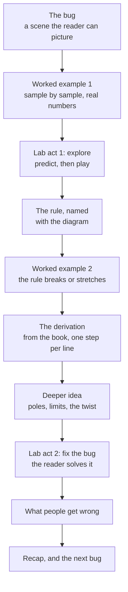

# Stage 1: the lesson's prose

Write the way a good teacher talks to one curious person: a natural teacher's voice with a storyteller's playfulness. Think of Andrej Karpathy building something live, or 3Blue1Brown asking "but why would that be true?" before answering. The reader should feel led, not briefed.

Never write in ASD-STE100 or controlled English. Short one-fact sentences in a row read like a manual. Learners described that style as "not natural, not like a human, not educational".

## The voice

- **Talk to the reader.** "You", and "we" when you work something out together. "Let's try it." "You might expect the average to halve it. It doesn't."
- **Vary the rhythm.** Mix long sentences that carry a thought with short ones that land it. A one-word sentence is fine when something surprising happens. Wow.
- **Ask before you tell.** Pose the question the reader should be asking, let it sit for a line, then answer it.
- **Admit surprise and difficulty.** "This part looks like a trick the first time." "Here is the strange bit."
- **Play, lightly.** A wry aside, a name for a thing ("the whine"), an exaggeration the reader enjoys. One or two per section. Never at the cost of a fact.
- **Plain words for ideas, exact words for terms.** "Averaging smooths fast wiggles" first, then "this is a low-pass filter".

## What stays strict

1. **One term for one thing.** Choose the key nouns and verbs on the teacher's sheet, and never swap in a synonym on any rung.
2. **Define every term before you use it**, in a sentence a newcomer can follow, with an example right after.
3. **Concrete before abstract.** Real numbers first, the general rule second, the notation last.
4. **Every claim is checkable.** Numbers are computed, not guessed. Run the arithmetic before you write it.
5. **No em dashes.**

## The story

Every lesson lives in its series' world (`series.md`) and opens on a bug the reader cannot fix yet. The lesson is the hunt. It ends when the reader fixes the bug, in the lab, with their own hands. Refer back to earlier lessons ("remember the whistle?"), because the series is one journey.

## Shape of the prose (15 to 20 minutes, about 2,000 to 3,000 words)



- **Worked examples** are tables or step lists the reader can follow with a pencil: inputs, each operation, each result. Show at least six samples. Name what the reader should notice before showing it.
- **The derivation** follows the book's notation, one step per line. Each line gets a plain sentence saying what changed and why. Formulas go in `\( ... \)` or `\[ ... \]` for `scripts/math.mjs`.
- **Close on a cliffhanger**: the next bug in the series.

## The teacher's sheet (`1-sheet.md`, never shown to the learner)

```markdown
# <lesson>
Objective: after this, you can ...
Bug: <what goes wrong in the world> · Fix: <what the reader does in act 2>
Key words: <noun> (not <synonym>), <verb> (not <synonym>)
Terms: <term>: <definition> (x3 to x6)
Misconception: <wrong belief> · Why wrong: <one sentence>
Worked examples: 1. <inputs and result> 2. <inputs and result>
Next bug: <cliffhanger>
Assumptions: ...
```

## Gates

1. **Read it aloud.** Synthesize each section with `agent-voice speak "<section>" --out <wav> --words`. In the returned words, look for what a listener trips on: words Whisper heard differently from the text (mispronounced or ambiguous), gaps over 0.6 s inside a sentence, and stretches where the pace jumps. Rewrite those sentences. Also rewrite any sentence over about 30 words that has no natural place to breathe. If the user declined the model download, read the prose sentence by sentence as if speaking it, and apply the same test.
2. **A fresh reader.** Spawn a subagent with no context. Brief it only as the audience ("a software engineer with no signal processing background who did lesson 1"). Give it only the prose. Ask it: where did you get lost, where were you bored, which sentence sounded unnatural, and what is the answer to the opening bug? Fix every point it raises, or say why not.
3. **Grep the key words** from the sheet for their synonyms.
4. **Review stop.** Show the user the prose and the sheet before building the page. The text is cheapest to change here.
