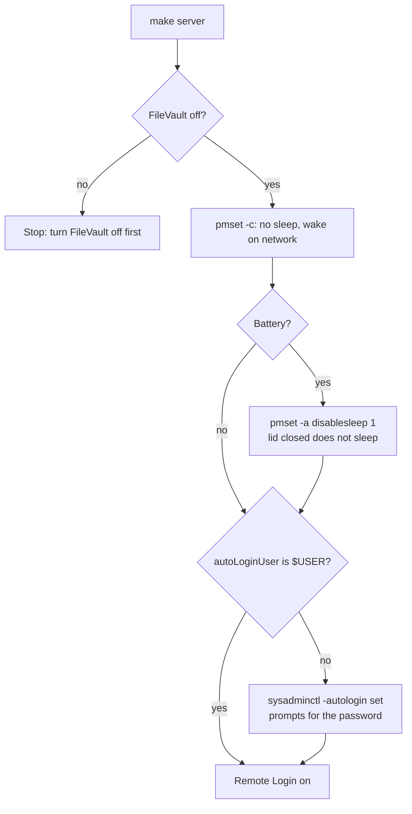

# Server Mode

`make server` turns a Mac into a homelab host: it stays awake, logs in by itself after a
reboot or a power loss, and accepts SSH. It is not part of `make all`, because a work laptop
must still sleep.

The homelab repository (`homelab-ansible`, role `macos_power`) checks these settings on each
Mac and fails when one is missing.

## Settings

| Setting | Value | Why |
| --- | --- | --- |
| `sleep`, `disksleep`, `standby` | `0` on the charger | The host answers at any time. |
| `womp`, `tcpkeepalive` | `1` on the charger | Wake on network, and keep connections alive. |
| `autorestart` | `1` | Power on after a power loss. Only desktops support it; the script skips it elsewhere. |
| `disablesleep` | `1`, laptops only | A closed lid does not put the Mac to sleep. |
| Automatic login | the current user | Launch agents (Postgres, Beszel) start at login. |
| Remote Login | on | Ansible connects over SSH. |

## FileVault

macOS refuses automatic login while FileVault is on: after a reboot it waits at the unlock
screen. Turn FileVault off in System Settings, Privacy and Security, and wait until
`fdesetup status` prints `FileVault is Off.` before running `make server`.

## Password

`sysadminctl` prompts for the login password and writes `/etc/kcpassword`. The password is never
stored in this repository or in a command line.
