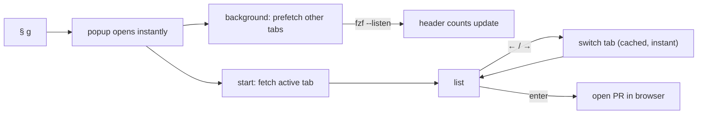
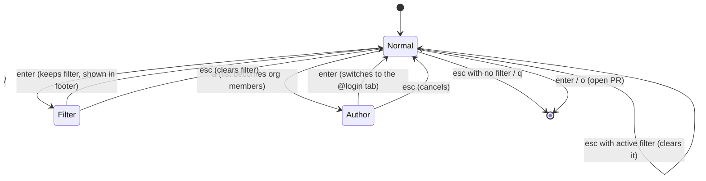

# tmux PR menu (`§ g`)

Popup with a tab bar on top, the PR list on the left and a preview on the right.

```
 ◀  Review requested (26) │ No review (9) │ Approved (1)  ▶
 ─────────────────────────────────────────────┬──────────────
 filter ›                              26/26  │ title: ...
 ▸ api-service#212        ABC-123 ...         │ state: OPEN
   web-frontend#248       ABC-456 ...         │ ...
 ─────────────────────────────────────────────┤
 ←/→ tab  ↑/↓ move  ⏎ open  ^o GitHub page    │
```



| Tab              | Query                                        |
| ---------------- | -------------------------------------------- |
| Review requested | `review-requested:@me`, excluding dependabot |
| No review        | `author:@me review:none`                     |
| Approved         | `author:@me review:approved`                 |
| By author        | `author:<login>`, person picked with `a`     |

Vim-style modes: the menu opens in **normal** mode (letters navigate). `/` enters **filter** mode (letters type).



| Key (normal mode) | Action                            |
| ----------------- | --------------------------------- |
| h / l (← / →)     | previous / next tab               |
| j / k (↑ / ↓)     | move through PRs                  |
| g / G             | first / last PR                   |
| J / K             | scroll preview one line           |
| ctrl-d / ctrl-u   | scroll preview half a page        |
| enter / o         | open PR in browser                |
| O                 | open the tab's GitHub search page |
| p                 | approve the selected PR           |
| a                 | pick a person, show their open PRs |
| /                 | filter the current tab            |
| r                 | refetch the current tab           |
| esc               | clear filter, or quit             |
| q                 | quit                              |

`a` swaps the list for the members of every GitHub org you belong to (or only those in `$PR_MENU_ORGS`, space-separated), showing display name and login, so typing filters by either. Enter picks the highlighted person; with no match, the typed text is used as a raw login. Members are cached in `~/.cache/tmux-pr-menu/` for a day and refreshed in the background when the popup opens.

`p` runs `gh pr review --approve` with no confirmation and reports the result in the footer. GitHub rejects approving your own PRs, so it only does something useful on the Review requested and By author tabs.

The preview is the PR summary (state, review decision, checks, diff size, reviewers, labels) plus the body, rendered as Markdown with `glow` and cached per PR.

Results are cached per popup in a temp dir, removed on exit. Requires `gh` (authenticated), `fzf` 0.65+, `glow` and `curl`.
