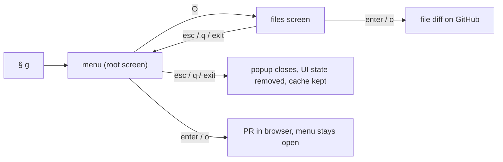
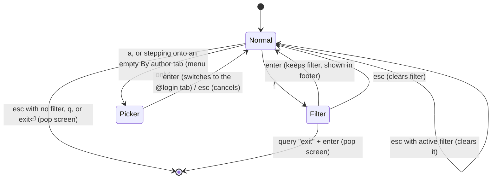
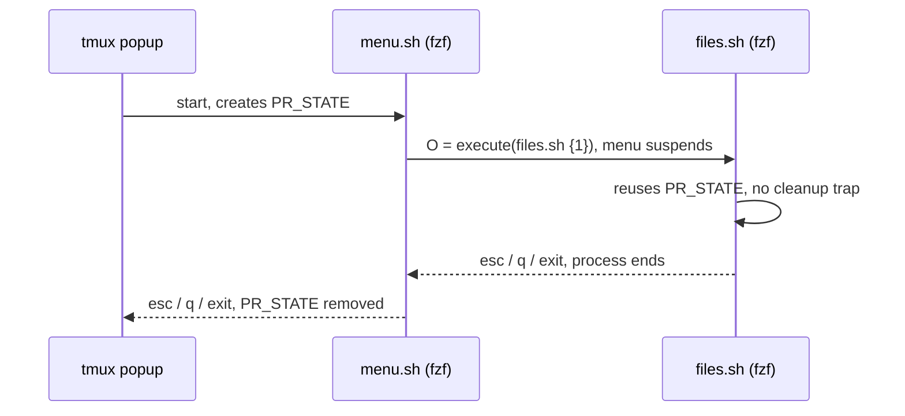
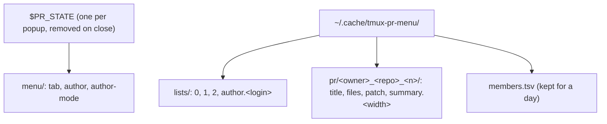
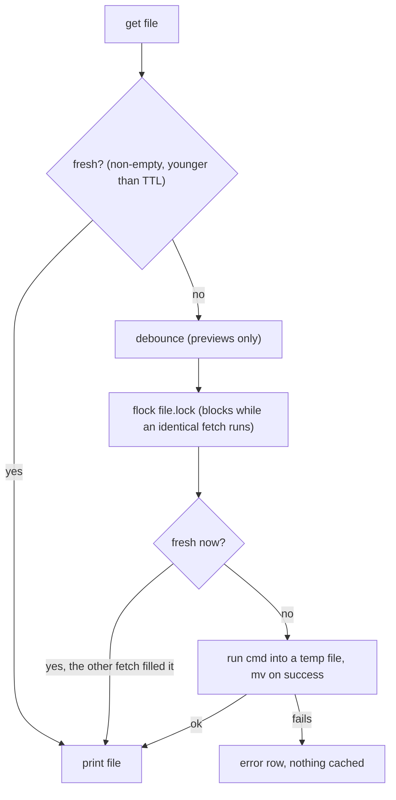

# tmux PR menu (`§ g`)

Full-screen popup for GitHub PRs, built as a stack of fzf screens. The menu is the root screen; `O` pushes the files-changed screen for the selected PR, and `esc` (or typing `exit` in filter mode, then enter) pops back.

```
 ◀  Review requested (26) │ No review (9) │ Approved (1) │ By author (…)  ▶
 ─────────────────────────────────────────────┬──────────────────────────────
 ▸ api-service#212        ABC-123 ...         │ # ABC-123 ...
   web-frontend#248       ABC-456 ...         │ - **State:** open
 ─────────────────────────────────────────────┤ - **Checks:** ✓ 12 ✗ 0 ● 1
 j/k move  ⏎/o open  O files  h/l tab  ...    │
```



| File                             | Role                                                       |
| -------------------------------- | ---------------------------------------------------------- |
| `scripts/tmux-pr-lib.sh`         | screen runtime: fzf command, shared keys, dispatch, cache  |
| `scripts/tmux-pr-menu.sh`        | root screen: tabs, author picker, approve, PR summary      |
| `scripts/tmux-pr-files.sh`       | files-changed screen: file list and per-file `delta` diff  |
| `scripts/tmux-pr-cache.py`       | response cache: TTL, single-flight lock, debounce, prune   |
| `scripts/tmux-pr-lint.sh`        | `make lint`                                                |
| `scripts/tmux-pr-test.bats`      | `make test`, offline, fake `gh` in `tmux-pr-fixtures/bin/` |
| `scripts/tmux-pr-smoke.sh`       | `make smoke`, drives the real UI in a throwaway tmux       |

Requires `gh` (authenticated), `fzf` 0.65+, `glow`, `delta`, `curl` and `python3` 3.8+ (stdlib only). Runs on macOS's bash 3.2.

## Keys

Every screen opens in **normal** mode (letters are commands). `/` switches to **filter** mode (letters type).



| Key             | Every screen               | Menu                               | Files screen         |
| --------------- | -------------------------- | ---------------------------------- | -------------------- |
| j / k, g / G    | move, first / last         |                                    |                      |
| J / K, ^d / ^u  | scroll preview             |                                    |                      |
| /               | filter                     |                                    |                      |
| esc, q, `exit`  | pop the screen             |                                    |                      |
| enter / o       |                            | open PR in browser (popup stays)   | open file on GitHub  |
| O               |                            | push files screen                  |                      |
| h / l, ← / →    |                            | previous / next tab                |                      |
| p               |                            | approve (no confirmation)          |                      |
| a               |                            | pick an author                     |                      |
| w               |                            | open the tab's GitHub search page  |                      |
| r               |                            | refetch the tab and its previews   | refetch the PR       |

| Tab              | Query                                        |
| ---------------- | -------------------------------------------- |
| Review requested | `review-requested:@me`, excluding dependabot |
| No review        | `author:@me review:none`                     |
| Approved         | `author:@me review:approved`                 |
| By author        | `author:<login>`, picked with `a`            |

The author picker lists members of every org you belong to (or only `$PR_MENU_ORGS`, space-separated). With no match, the typed text is used as a raw login. GitHub rejects approving your own PRs, so `p` is only useful on Review requested and By author.

## Adding a screen

A screen is a script that sources the lib, defines a few functions, and calls `pr_main`. Push it from another screen with `$(pr_push <name>)`, which runs `scripts/tmux-pr-<name>.sh {1}`.

```bash
#!/usr/bin/env bash
set -u
# shellcheck source-path=SCRIPTDIR source=tmux-pr-lib.sh
source "$(dirname -- "${BASH_SOURCE[0]}")/tmux-pr-lib.sh" || exit 1

screen_footer='c comment'                                # hints, shared ones are appended
screen_binds=("c:execute($PR_RUN comment {1})")          # single letters auto-unbind in filter mode
screen_fzf_opts=(--preview-window=right:60%:border-left) # appended last, so they override

screen_init()    { [[ ${1-} == https://* ]] || return 2; export PR_THING_URL=$1; }
screen_header()  { printf '%s' "header line"; }
screen_list()    { printf '%s\t%s\n' "key" "display"; } # key reaches every hook as {1}
screen_preview() { printf 'preview for %s\n' "$1"; }
screen_on_enter() { printf 'execute-silent(%s open {1})' "$PR_RUN"; } # default: accept

cmd_comment() { gh pr comment "$PR_THING_URL" --body "$1"; } # cmd_* = subcommand

pr_main "$@"
```



Optional hooks: `screen_start` (root setup after the state dir exists), `screen_on_accept <key>` (after fzf exits with a selection), `screen_enter_hook` / `screen_esc_hook` (return 0 to take over the key, as the author picker does).

Helpers: `pr_row_error`, `pr_row_empty` (rows with key `x` are ignored by every hook), `pr_cached <file> <subcommand> [args]` and `pr_cached_preview` (same, debounced; the fetcher is a `cmd_*` of the calling screen), `pr_refresh_cooling <file>`, `pr_dir <url>`, `pr_forget <url>`, `pr_ref <url>`, and `PR_FILTER`, `PR_NORMAL`, `PR_RESTORE` for building mode-switching actions.

## State and cache

UI state (current tab, picked author, picker mode) lives in `$PR_STATE`, one temp dir per popup. GitHub responses live in `~/.cache/tmux-pr-menu/` and are shared by every popup, so reopening `§ g` within the TTL makes no `gh` calls.



Every read goes through `tmux-pr-cache.py get <file> -- <cmd>`:



| Setting                  | Default | Effect                                                                 |
| ------------------------ | ------- | ---------------------------------------------------------------------- |
| `PR_CACHE_TTL`           | 300 s   | how long a response is served without calling `gh`                     |
| `PR_PREVIEW_DEBOUNCE`    | 0.3 s   | wait before an uncached preview fetch; fzf kills it if you move on     |
| `PR_REFRESH_COOLDOWN`    | 10 s    | `r` within this long after a fetch only reports the age in the footer  |

| Event          | Invalidates                                                         |
| -------------- | ------------------------------------------------------------------- |
| `r` on menu    | the current tab's list and the cached previews of every PR in it    |
| `r` on files   | that PR's title, files, patch and summaries                         |
| `p` approve    | that PR and every list, then reloads the tab and re-prefetches      |
| popup start    | cache files older than a day                                        |

The lock is a kernel `flock`, so a fetch killed mid-flight (fzf cancelling a preview) releases it immediately.

## Lint

`make lint` runs locally and in CI (`.github/workflows/shellcheck.yml`):

- shellcheck on every tracked `*.sh` (zsh scripts excluded), following sourced files
- for `tmux-pr-*` files, the test file and the fake binaries: optional shellcheck checks (`require-double-brackets`, `quote-safe-variables`, `check-unassigned-uppercase`, `deprecate-which`), `shfmt -i 2 -ci -bn`, `/bin/bash -n`, and a ban on bash 4+ features (`mapfile`, `declare -A`, `${x,,}`, `|&`, negative indexes, …)

## Tests

`make test` (local and CI) runs `scripts/tmux-pr-test.bats` with `scripts/tmux-pr-fixtures/bin` first on `PATH`. The fake `gh` serves the JSON fixtures through the scripts' real `--jq` programs and logs every call to `$GH_LOG`; fake `delta`, `glow`, `open` and `curl` pass through or log.

`make smoke` (local only, needs `fzf` and `tmux`) opens the menu on a separate tmux server with the same fakes and checks: menu loads, `O` pushes, enter opens a file, `esc` pops, `l` switches tab, `exit` closes.
